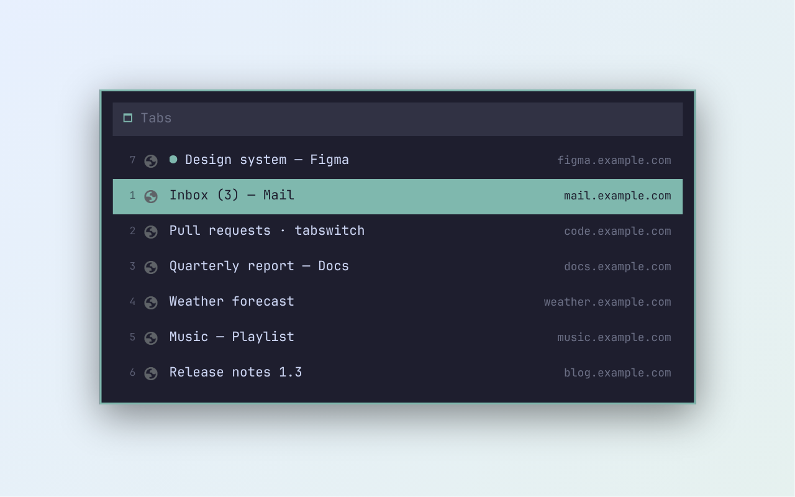

# Tab Switch

A fast, minimal tab switcher for Chrome. Press **Alt+Q** and every open tab appears in one centered list —
numbered like the tab strip, grouped by window, searchable as you type.



## Keys

| Key | Action |
|---|---|
| **Alt+Q** | Open the list. The current tab is highlighted |
| **Alt+Q** again (keep Alt held) | Move down; release **Alt** to switch |
| Type | Filter by title and address |
| **↑ ↓**, **Tab** | Move |
| **Enter** | Switch to the tab (focuses its window) |
| **Delete** / **Ctrl+Backspace** | Close the highlighted tab |
| **Esc** | Close the list |
| **Alt+W** | Jump to the previous tab and back |
| **Alt+← / Alt+→** | Neighbour tab in this window (wraps around). Replaces Chrome's keyboard Back/Forward |

- Current window first, other windows below under «Window 2 · <its active tab>».
- Light and dark look follow Chrome's appearance setting, live.
- Size never jumps: fixed when opened, unaffected by page zoom.
- On Chrome's own pages (New Tab, `chrome://…`) extensions can't draw inside the page, so the same list opens
  as a small window over Chrome.
- Shortcuts can be changed at `chrome://extensions/shortcuts`.

## Privacy

Nothing leaves your browser. No analytics, no network requests, no data stored except a development marker.
See [PRIVACY.md](PRIVACY.md).

## Install from source

1. `chrome://extensions` → enable **Developer mode**.
2. **Load unpacked** → select this folder.

## Develop

Requires [`just`](https://github.com/casey/just) and Playwright (`npm i -g @playwright/cli` provides it).

```
just check    # syntax + behaviour tests in Chromium (Playwright)
just reload   # after editing: the next Alt+Q in your Chrome reloads the extension
just icons    # icons/icon-*.png from icons/src/layers.svg
just screens  # store screenshots 1280×800
just pack     # tabswitch.zip for the Chrome Web Store
```

## Credits

Icon: [Lucide](https://lucide.dev) «layers» (ISC license). Colors: [Catppuccin](https://catppuccin.com) Mocha / Latte.

## License

MIT

---

## По-русски

Быстрый минималистичный переключатель вкладок Chrome. **Alt+Q** — все вкладки одним списком по центру: с номерами,
как в полоске вкладок, по окнам, с поиском. Держишь Alt и жмёшь Q — подсветка ниже, отпустил Alt — переход.
**Alt+W** — на прошлую вкладку и обратно. **Alt+← / Alt+→** — соседняя вкладка в этом окне. Светлая и тёмная тема — как у Chrome.
